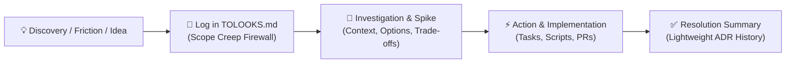

# ToLooks: Exploratory Scratchpad & Architectural Decision Backlog

A standardized pattern across repositories for capturing backlog ideas, technical investigations, architectural inquiries, and living decision records without scope creep.

---

## 1. What is "ToLooks"?

The term **ToLooks** is a deliberate wordplay on **ToDos**:
- A **ToDo** is an actionable, committed, scheduled task ready for immediate or near-term execution.
- A **ToLook** is an exploratory inquiry, investigative spike, architectural question, or newly discovered edge case—something to *look into* rather than immediately implement.

A repository's `TOLOOKS.md` serves as a dedicated, version-controlled scratchpad living directly at the root of the project. It bridges the gap between ephemeral conversational ideas and concrete task execution.



---

## 2. Core Principles

### 🛡️ The Scope-Creep Firewall
During active development or pairing sessions with autonomous agents, developers frequently discover tangential improvements, edge cases, potential refactors, or optimization opportunities. 

Derailing the active task to pursue these side quests introduces regression risk and inflates pull requests. Ignoring them causes valuable insights to be lost forever. 

**Rule:** When a tangential idea or edge case surfaces during an active task, do not code it immediately. Record it in `TOLOOKS.md` with its trigger context and return to the primary objective.

### 🔬 Investigate Before Committing
Complex architectural decisions require research before execution. A ToLook provides a designated space to:
- Document problem symptoms and root causes.
- Compare candidate architectures and trade-offs.
- Outline phased migration plans or verification matrices.

### 📜 Living Architectural Decision Record (ADR)
Traditional ADRs often languish in siloed folders, disconnected from the daily engineering loop. When a ToLook is resolved:
1. Mark the checkbox `[x]`.
2. Add a concise `Resolution` summary linking to the implemented scripts, PRs, or commits.
3. Keep the completed entry in place.

Over time, `TOLOOKS.md` naturally becomes a chronological, lightweight architectural decision history explaining *why* the codebase evolved the way it did.

---

## 3. Anatomy of a ToLook

Every item in `TOLOOKS.md` follows a structured template:

### Active Item (Unresolved)
```markdown
- [ ] **<Number or Slug>. <Title>**
  - **Idea**: A concise 1–2 sentence statement of what to explore, build, or refactor.
  - **Context**: Why this matters. What triggered the idea? What failure mode, edge case, or friction does this address?
  - **Investigation**: Concrete exploration steps, math/formulas, schema proposals, candidate options with trade-offs, or a phased implementation checklist.
```

### Resolved Item
```markdown
- [x] **<Number or Slug>. <Title>**
  - **Status**: Implemented in [`path/to/script.sh`](path/to/script.sh) / PR #123.
  - **Resolution**:
    1. Concise summary of the architectural decision made.
    2. Concrete changes implemented and files touched.
    3. Rationale for why alternative approaches were rejected.
```

---

## 4. Illustrative Patterns & Usage

### Pattern A: Isolating Edge Cases & Domain Spikes
When building a continuous data ingestion, event processing, or calculation pipeline, unexpected edge cases inevitably arise in upstream feeds (e.g., non-standard scoring rules, schema drift, or ambiguous domain labels).

Rather than hastily hacking conditional branches into production scripts during an active task, the developer or agent isolates the problem into a dedicated ToLook:

```markdown
- [ ] **12. Support Dynamic & Non-Standard Scoring Rules**
  - **Idea**: Dynamically handle non-standard scoring systems (e.g., 3-point win escalations or custom penalty weights) without corrupting default calculation pipelines.
  - **Context**: Upstream data sources introduced events where scoring rules vary by tier. Hardcoded default weights cause reconstructed rankings and tiebreakers to diverge from official leaderboards.
  - **Investigation**:
    1. *Schema Audit*: Inspect upstream payload schema to see if custom point weights are exposed per event.
    2. *Accumulator Support*: Update calculation logic to dynamically apply custom weights when present, defaulting to standard weights when omitted.
    3. *Threshold Scaling*: Adjust qualification thresholds dynamically based on the maximum win points available for that round.
```

When resolved, the item is updated in place to become part of the repository's decision history:

```markdown
- [x] **12. Support Dynamic & Non-Standard Scoring Rules**
  - **Status**: Implemented in [`scripts/calculate-standings.sh`](scripts/calculate-standings.sh).
  - **Resolution**:
    1. Added support for optional `customScoring` object in event snapshots; falls back to default scoring when absent.
    2. Scaled qualification delta thresholds dynamically by the event's maximum available win points.
    3. Point-in-time snapshot immutability preserves historical calculations without dedicated schema migration scripts.
```

### Pattern B: Architectural Design Spikes & Technology Evaluations
When evaluating a significant architectural shift (e.g., standardizing toolchain version pinning, replacing brittle CI dependencies, or redesigning storage layouts), a ToLook provides a structured workspace for option comparisons and phased migration plans:

```markdown
- [ ] **Unified Toolchain Version Management Across Repositories**
  - **Idea**: Establish a standardized architecture for pinning, updating, and auditing toolchain versions across projects to eliminate brittle CI steps.
  - **Context**: Multiple repositories currently use conflicting version sources (inline workflow variables, dedicated version files, third-party version managers). Upstream CI runner changes frequently break automated updaters that rely on heavy package managers.
  - **Investigation & Design Blueprint**:
    - *Candidate Options*:
      - **Option A (Pinned Version Files)**: Single-line version files read directly by CI actions (`cat VERSION`); zero third-party dependencies.
      - **Option B (Version Manager Config)**: Standard toolchain config files (`.tool-versions`); native local developer experience.
      - **Option C (Hybrid)**: Support standard config files locally while using zero-dependency manifest queries in CI.
    - *Phased Rollout*:
      - [ ] Phase 1: Prototype zero-dependency manifest queries in core repositories.
      - [ ] Phase 2: Add multi-project audit script to inspect version drift.
      - [ ] Phase 3: Roll out to downstream projects.
```

In a higher-level milestone tracker (such as `todo.md` or an issue tracker), the scheduled task remains concise and links directly to `TOLOOKS.md` for the technical context:

```markdown
- [ ] **Standardize Toolchain Version Management**
  - Context & Architecture Blueprint: [TOLOOKS.md](TOLOOKS.md)
```

---

## 5. Working with Autonomous Agents

For autonomous coding agents (such as Antigravity, Claude Code, or Jules), `TOLOOKS.md` provides crucial guardrails:

| Agent Behavior | Without ToLooks | With ToLooks |
| :--- | :--- | :--- |
| **Encountering unexpected edge case** | Haphazardly modifies existing code outside task scope, risking breakage. | Records the edge case in `TOLOOKS.md` with context; stays focused on active task. |
| **Spotting refactoring opportunities** | Begins premature refactoring, expanding PR diffs and stalling delivery. | Notes refactor idea under a new ToLook; keeps PR small and cohesive. |
| **Session resumption & handoff** | Loses train of thought between turns or after context resets. | Reads `TOLOOKS.md` to instantly regain context on in-flight investigations. |
| **Completing an investigation** | Commits code without capturing the rationale for architectural choices. | Marks item `[x]` with a concise `Resolution` explaining the decision. |

---

## 6. Starting a `TOLOOKS.md` in Your Project

To introduce ToLooks to a repository:
1. Copy the starter template from [template.md](template.md) to your repository root as `TOLOOKS.md`.
2. Reference `TOLOOKS.md` in your project's root `AGENTS.md` and `README.md`.
3. Add ideas, edge cases, and architectural spikes as they arise.

---

## Related Seed Files

- [template.md](template.md): Clean starter template for `TOLOOKS.md`.
- [../README.md](../README.md): Seed folder overview and propagation rules.
- [../../AGENTS.md](../../AGENTS.md): Root repository agent guidelines and ToLooks rules.
